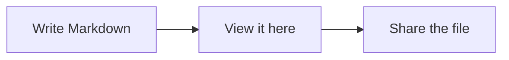

# Markdown Viewer

Open a Markdown file with **File → Open** (Ctrl+O), or drag and drop one onto this window.

## Shortcuts

| Action                     | Shortcut          |
| -------------------------- | :---------------: |
| Open a file                | Ctrl+O            |
| Toggle side-by-side editor | Ctrl+E            |
| Save / Save as             | Ctrl+S / Ctrl+Shift+S |
| Reload from disk           | F5                |
| Find in document           | Ctrl+F            |
| Zoom                       | Ctrl+Mouse wheel  |
| Print                      | Ctrl+P            |

## What gets rendered

- *Italic*, **bold**, ~~strikethrough~~ and `inline code`
- [Links](https://commonmark.org) and [jumps within the document](#tips)
- Nested lists
  1. Numbered
  2. Items
- Tables, block quotes, images and footnotes[^1]

- [x] Task lists
- [ ] Unchecked items

> Block quotes look like this.

```csharp
// Code blocks keep their formatting and get syntax colors
var greeting = "Hello, Markdown!";
Console.WriteLine(greeting); // ```sql, ```json, ```xml ... work too
```

Mermaid code blocks are drawn as diagrams:



---

## Tips

The file is watched while open: if another program changes it, the view refreshes automatically
(as long as you have no unsaved edits).

**Journal:** press **Ctrl+J**, write a note and press Ctrl+Enter. It is stamped with the date and time and put at
the top of `journal.md`; **Ctrl+Shift+J** opens the journal.

**Macros:** in the editor, type `@730` followed by a space and it becomes a link to task 730.
Change or add macros under **Tools → Macros**.

**Links:** keep the sites you use often under the **Links** menu. Add them with **Links → Edit links**.

**Trash and archive:** right-click a file or post-it note → **Move to trash** (Ctrl+Del) or **Archive**. Both have
their own shelf at the end of the bookshelf list, with **Restore** to put things back. **Todo → Archive done tasks**
moves the ticked tasks of the todo list to the archive.

[^1]: Footnotes appear at the bottom of the document.
